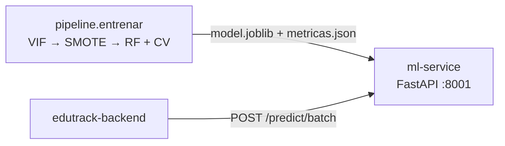

# edutrack-ml

Microservicio de predicción de riesgo académico e investigación de Machine Learning de **EduTrack**.

| Carpeta | Qué contiene |
|---|---|
| [`ml-service/`](ml-service) | Pipeline de entrenamiento (`pipeline/`) y API FastAPI que carga el modelo Random Forest y responde `/predict`. Es lo que se despliega. |
| [`ml-research/`](ml-research) | Notebooks de EDA, VIF, SMOTE, entrenamiento y evaluación. No se despliega. |
| [`docs/ml/`](docs/ml) | [Evaluación del modelo](docs/ml/MODEL_EVALUATION.md), [descripción del dataset](docs/ml/DATASET_DESCRIPTION.md) y [model card](docs/ml/MODEL_CARD.md). |



## Estado del modelo publicado

| Versión | F1 (prueba) | AUC‑ROC (prueba) | RNF‑02 (F1 ≥ 0,75 y AUC > 0,80) |
|---|---|---|---|
| `rf-20261127-7734085c` | 0,755 | 0,923 | ✅ Cumple (validación cruzada F1 0,748 ± 0,019: margen pequeño) |

Entrenado con **datos sintéticos** (10 000 filas; la versión anterior, con 2 000, tenía F1 0,740). Métricas completas en [`ml-service/reports/metricas.json`](ml-service/reports/metricas.json).

## Contrato de la API (lo consume `edutrack-backend`, no cambiarlo sin avisar)

`POST /predict`

```json
{
  "student_id": 1,
  "features": {
    "promedio": 11.5, "inasistencias": 6, "conducta": 2, "horas_estudio": 3,
    "nivel_edu_padres": 2, "acceso_tecnologia": 1, "tiempo_disponible_padres": 2,
    "comunicacion_familiar": 2, "cursos_desaprobados": 2, "tareas_entregadas_pct": 0.6
  },
  "umbral_amarillo": 0.4,
  "umbral_rojo": 0.7
}
```

Respuesta:

```json
{ "student_id": 1, "riesgo": "rojo", "probabilidad": 0.82, "factores": ["promedio", "cursos_desaprobados"], "modelo_version": "rf-20261127-7734085c" }
```

- `riesgo`: `verde` (< umbral_amarillo), `amarillo`, `rojo` (≥ umbral_rojo). Los umbrales son opcionales (por defecto 0.4 y 0.7).
- `factores`: variables que más elevan el riesgo **de ese estudiante** (oclusión contra el perfil típico sin riesgo). Vacío para estudiantes en verde.
- `POST /predict/batch`: lista de requests → lista de respuestas.
- `GET /health` y `GET /modelo` (versión, variables, umbral, métricas y `evaluacion`: el reporte completo de entrenamiento —matriz de confusión, sensibilidad al umbral, importancia de variables, VIF—). La evaluación viaja dentro de `model.joblib`; para modelos anteriores se lee de `reports/metricas.json` solo si es de la misma versión.
- Documentación interactiva: http://localhost:8001/docs

## Correr en local

```bash
cd ml-service
python -m venv .venv
source .venv/bin/activate        # Windows: .venv\Scripts\activate
pip install -r requirements-dev.txt
python -m pipeline.entrenar      # genera model/model.joblib y reports/metricas.json
                                 # termina con código 1 si no cumple RNF-02;
                                 # --forzar publica el modelo igual (solo para demo)
uvicorn app.main:app --reload --port 8001
pytest --cov=app --cov=pipeline
```

Con Docker:

```bash
cd ml-service
docker build -t edutrack-ml .
docker run -p 8001:8001 edutrack-ml
```

## Pipeline de entrenamiento

1. Dataset sintético reproducible (`pipeline/dataset.py`, semilla 42) y limpieza.
2. División estratificada 80/20; la prueba solo se usa al final.
3. VIF en entrenamiento (descarta VIF > 5).
4. `Pipeline(SimpleImputer → SMOTE → RandomForest)` con `GridSearchCV` y `StratifiedKFold(5)`.
5. Umbral de decisión elegido con predicciones fuera de *fold* del entrenamiento.
6. Reporte de métricas y *quality gate* RNF‑02. Versión `rf-AAAAMMDD-hash`.

Los `.joblib` no se versionan en Git. El reentrenamiento automático (MLOps) está fuera del alcance del MVP.
