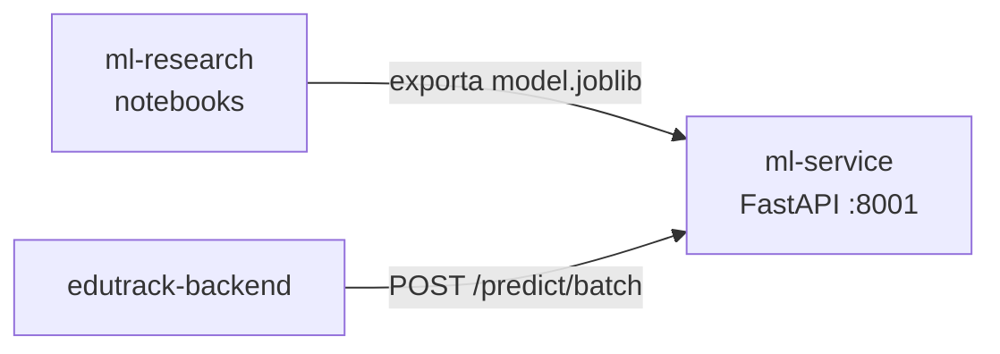

# edutrack-ml

Microservicio de predicción de riesgo académico e investigación de Machine Learning de **EduTrack**.

| Carpeta | Qué contiene |
|---|---|
| [`ml-service/`](ml-service) | API FastAPI que carga el modelo Random Forest y responde `/predict`. Es lo que se despliega. |
| [`ml-research/`](ml-research) | Notebooks de EDA, VIF, SMOTE, entrenamiento y evaluación. No se despliega. |



## Contrato de la API (lo consume `edutrack-backend`, no cambiarlo sin avisar)

`POST /predict`

```json
{
  "student_id": 1,
  "features": {
    "promedio": 11.5, "inasistencias": 6, "conducta": 2, "horas_estudio": 3,
    "nivel_edu_padres": 2, "acceso_tecnologia": 1, "tiempo_disponible_padres": 2,
    "comunicacion_familiar": 2, "cursos_desaprobados": 2, "tareas_entregadas_pct": 0.6
  },
  "umbral_amarillo": 0.4,
  "umbral_rojo": 0.7
}
```

Respuesta:

```json
{ "student_id": 1, "riesgo": "rojo", "probabilidad": 0.82, "factores": ["promedio", "cursos_desaprobados", "inasistencias"] }
```

- `riesgo`: `verde` (< umbral_amarillo), `amarillo`, `rojo` (≥ umbral_rojo). Los umbrales son opcionales (por defecto 0.4 y 0.7).
- `factores`: las 3 variables con mayor importancia en el modelo.
- `POST /predict/batch`: recibe una lista de requests y devuelve una lista de respuestas.
- Documentación interactiva: http://localhost:8001/docs

## Correr en local

```bash
cd ml-service
python -m venv .venv
source .venv/bin/activate        # Windows: .venv\Scripts\activate
pip install -r requirements-dev.txt
python scripts/train_dummy.py    # genera model/model.joblib con datos sintéticos
uvicorn app.main:app --reload --port 8001
pytest --cov=app
```

Con Docker:

```bash
cd ml-service
docker build -t edutrack-ml .
docker run -p 8001:8001 edutrack-ml
```

## Flujo del modelo

1. **Hoy:** `train_dummy.py` entrena con datos **sintéticos** para que backend y frontend puedan integrarse desde el día 1.
2. **Después:** en `ml-research/` se entrena el modelo real (VIF → SMOTE → Random Forest).
3. Cuando cumpla **F1 ≥ 0.75 y AUC-ROC > 0.80**, se exporta a `ml-service/model/model.joblib` y se publica como *release* del repo (los `.joblib` no se versionan en Git).

> El reentrenamiento automático (MLOps) está fuera del alcance del MVP.
